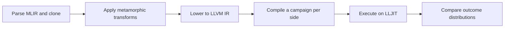

# MLIR-MRacle

A metamorphic testing harness for OpenMP concurrency programs in MLIR.

[](LICENSE)
[]()
[]()

## Overview

MLIR-MRacle is a metamorphic testing tool for OpenMP MLIR programs. It applies
memory model-related metamorphic relations (MRs) to transform a program, runs
both the original and the transformed versions on LLJIT, and compares their
outcome sets. Drastic changes in results across the source and transformed programs point to a bug in OpenMP lowering.

This project investigates a metamorphic-testing approach for concurrency and
memory models, developed during an MLSystems research internship. Conventional
testing assumes single-thread execution and falls short on reproducibility
because of nondeterminism and varying memory models across hardware. Metamorphic relations sidestep these problems, alongside the oracle problem.

MLIR-MRacle is (afaik) the first MLIR fuzzer that can generate valid concurrent
programs with respect to concurrency constructs and the native
memory model, allowing the systematic exploration of a whole class of MLIR programs that was previously out of reach.

## Repository layout

```text
.
├── mlir-mracle/
│   ├── include/mlir-mracle/   # public headers
│   └── src/
│       ├── app/               # mlir_mracle_opt CLI driver
│       └── lib/
│           ├── backend/
│           │   ├── jit/       # JIT-compiles LLVM modules for execution
│           │   └── lowering/  # lowers MLIR to LLVM IR
│           ├── context/       # shared data structures and outcome-set types
│           ├── execution/     # runs compiled binaries and collects observed outcomes
│           ├── io/            # serializes results and dumps IR artifacts
│           ├── legacy/        # legacy thread-group oracle pipeline (--mode=legacy)
│           ├── oracle/        # compares outcome distributions and derives verdicts
│           ├── pipeline/      # pipeline orchestration, emit and execution modes
│           └── passes/        # metamorphic transformation passes
├── fuzzing/
│   ├── fuzz_mracle.py         # primary campaign runner
│   └── corpus/
│       └── seeds/             # litmus-style MLIR seed programs
├── debug-progs/               # small MLIR programs for manual debugging
├── CMakeLists.txt
├── Dockerfile
└── requirements.txt
```

## Architecture



1. Parse the input module and clone it.
2. Apply one or more seeded, semantics-preserving transforms from the
   registry to the clone.
3. Lower both modules to LLVM IR.
4. Collect independent campaigns for both sides on LLJIT.
5. Compare the observed outcome distributions and report a verdict.

## Features

- 20+ seeded metamorphic transformations (see [Transforms](#transforms)).
- Three comparison oracles over the same campaign protocol — agitation,
  distributional and noise-calibrated (see [Modes](#modes)).
- Structured campaign output with per-run JSON reports and artifacts (see [Output layout](#output-layout)).
- Campaign checkpointing and resuming, so an interrupted campaign can be continued via `--campaign-dir`.
- Python runner and over 30+ litmus-style seeds in `./fuzzing/corpus/seeds`.
- Extensible to any memory model; ARMv8 currently supported

## Quick start

### Prerequisites

- Docker, or natively: `uv` (provides Python 3.12, CMake, and Ninja), a C++23
  compiler, and OpenMP (Homebrew `libomp` on Apple Silicon is auto-detected).
- LLVM/MLIR come from the `mlir-wheel` package pinned in `requirements.txt`.

### Native build

```bash
uv python install 3.12
uv venv --python 3.12
uv pip install -r requirements.txt

.venv/bin/cmake -G Ninja -S . -B build -DCMAKE_BUILD_TYPE=Release \
  -DCMAKE_PREFIX_PATH=$(.venv/bin/python -m mlir_wheel --root-dir)

.venv/bin/cmake --build build --target mlir_mracle_opt -j
```

> [!TIP]
> The Python runner builds `mlir_mracle_opt` for you on first use, so the
> native build is optional for normal use.

### Docker

```bash
git clone https://github.com/dakaidan/MLIR-MRacle.git
docker build -t mlir-mracle .
docker run -it --rm mlir-mracle /bin/bash
```

> [!NOTE]
> `mlir_mracle-smoke` is a stable Docker build target that currently just
> echoes configuration success.

## Running MLIR-MRacle

### Python runner (recommended)

```bash
.venv/bin/python fuzzing/fuzz_mracle.py fuzzing/corpus/seeds
```

Examples:

```bash
# single litmus test
.venv/bin/python fuzzing/fuzz_mracle.py fuzzing/corpus/seeds/iriw.mlir

# fixed seed, one random file from the corpus per run
.venv/bin/python fuzzing/fuzz_mracle.py --seed=7 --multi fuzzing/corpus/seeds

# restrict to fence transforms
.venv/bin/python fuzzing/fuzz_mracle.py --transform=insert-fence,remove-fence fuzzing/corpus/seeds/iriw.mlir

# add ARMv8-specific commutations
.venv/bin/python fuzzing/fuzz_mracle.py --model=armv8 fuzzing/corpus/seeds/iriw.mlir

# emit transformed MLIR only
.venv/bin/python fuzzing/fuzz_mracle.py --mode=emit --transform=insert-fence fuzzing/corpus/seeds/iriw.mlir

# resume an interrupted campaign
.venv/bin/python fuzzing/fuzz_mracle.py --campaign-dir=path/to/campaign fuzzing/corpus/seeds

# the distributional comparison, then the calibrated one
.venv/bin/python fuzzing/fuzz_mracle.py --mode=tvd fuzzing/corpus/seeds/iriw.mlir
.venv/bin/python fuzzing/fuzz_mracle.py --mode=calibrated fuzzing/corpus/seeds/iriw.mlir
```

### Using the binary directly

```bash
.venv/bin/cmake --build build --target mlir_mracle_opt -j
build/mlir-mracle/src/app/mlir_mracle_opt [options] <path-to-mlir-file>
```

The binary prints the campaign directory on stdout and accepts the same options as the Python driver.

### Options

| Option | Meaning |
| --- | --- |
| `--mode` | pipeline mode(s), comma-separated: `emit`, `execution`, `legacy`, `compare` (default), `tvd`, `calibrated` |
| `--model` | memory model gate: empty = generic transforms only, `armv8` adds ARMv8-specific ones |
| `--iter` | number of pipeline repetitions (default 1) |
| `--transform` | restrict the transform set (repeat or comma-separate) |
| `--apply` | max transform applications per run |
| `--multi` | pick a random `.mlir` file from a folder per run |
| `--seed` | fixed RNG seed |
| `--campaign-dir` | resume/continue a campaign, or the emit-mode output directory |
| `--no-cache` | disable the persistent on-disk cache |
| `--reps` | `compare`, `execution`, `emit`: executions per variant configuration (default 5000), per file, or transform picks |
| `--reruns`, `--max-runs` | `compare`, `legacy`: replay-round budget (default 5000) and the cap on executions spent on one baseline (default 100000) |
| `--threshold` | `compare`, `legacy`: share of runs, in percent, at which a one-sided outcome stops being rare (default 5) |
| `--campaigns` | `tvd`, `calibrated`: campaigns per variant before the first verdict, and the size of each later batch (default 10) |
| `--max-campaigns` | `tvd`, `calibrated`: campaign cap while undecided (default 50, 30 with `calibrated`) |
| `--executions-per-campaign` | `tvd`, `calibrated`: executions per campaign (default 2000, 1000 with `calibrated`) |
| `--team-size` | `tvd`, `calibrated`: OpenMP team size, identical for both variants (default 4) |
| `--tvd-threshold` | `tvd`: tolerated distributional discrepancy (default 0.05) |
| `--min-change` | `calibrated`: smallest change worth reporting, in squared Hellinger distance (default 0.005) |
| `--bootstrap` | `tvd`, `calibrated`: resampling replicates, for the interval and for the noise envelope (default 2000) |
| `--confidence` | `tvd`, `calibrated`: confidence of the interval, and of the calibrated bar (default 0.95) |

See `.venv/bin/python fuzzing/fuzz_mracle.py --help` for the full list.

### Environment variables

| Variable | Default | Meaning |
| --- | --- | --- |
| `MLIR_MRACLE_BUILD_DIR` | `<repo>/build` | Where the runner locates (and on first use builds) `mlir_mracle_opt`. |
| `MLIR_MRACLE_CACHE_DIR` | `cache/v2` | Root of the artifact cache; an explicitly empty value disables caching. |

## Transforms

Transforms are the seeded, semantics-preserving mutations applied to the cloned program; each one declares the outcome-set relation it preserves and the memory model it targets.

Each transform declares the outcome-set relation it preserves; a run compares
in the direction given by the composition of the transforms actually applied.
Transforms also declare a memory-model target, and the set of applicable
transforms is resolved from the requested model (`--model`): `generic`
transforms are always included, and a non-empty model adds the transforms
targeting that model.

### Generic concurrency transforms

Always available and valid under every memory model.

| Transform | Effect | Relation |
| --- | --- | --- |
| `insert-fence` | insert `omp.flush` inside a thread region | subset |
| `remove-fence` | remove a random `omp.flush` | superset |
| `insert-fence-between-mem-ops` | insert `omp.flush` between atomic memory ops | subset |
| `insert-fence-around-seq-cst` | `omp.flush` around a seq_cst atomic op | equality |
| `insert-atomic-cas` | no-op CAS on a fresh thread-local location | equality |
| `insert-atomic-write` | atomic write of 0 to a thread-local dummy | equality |
| `insert-atomic-read` | atomic read of an in-scope memref | equality |
| `insert-read-arith` | wrap an atomic write expr in `add/sub 0` | equality |
| `insert-random-arith` | fresh memref + arith chain in a thread region | equality |
| `insert-random-memref` | fresh memref load/store chain in a thread region | equality |
| `insert-jitter` | delay chains in gaps around shared-memory ops | equality |
| `insert-comparison` | self-comparisons after a thread value | equality |
| `insert-both-arms-if` | duplicate a chain into both arms of `scf.if` | equality |
| `insert-parallel` | new `omp.parallel` with random sections | equality |
| `insert-critical` | wrap a thread-local chain in `omp.critical` | subset |
| `local-store-duplication` | duplicate a thread-local store | equality |
| `load-reordering` | shuffle eligible loads inside threads | equality |
| `relax-operation` | weaken atomic memory order one stage | superset |
| `restrict-operation` | strengthen atomic memory order one stage | subset |
| `unroll-single-thread` | unroll a single-section `omp.parallel` | equality |

### Memory-model-specific transforms

Transforms for a specific memory model live under
`mlir-mracle/src/lib/passes/transforms/<model>/` e.g. the ARMv8 relaxed
commutations in `transforms/arm/ArmTransforms.cpp`. 

Each declares its target via
`getTarget()` (`MetamorphicTransform.h`), and `getTransforms()` in
`MetamorphicTransform.cpp` adds it to the applicable set only when the
requested `--model` matches.

## Modes

Every mode shares the same front half — parse, clone, apply the metamorphic
transforms, lower and compile — and differs in what it does with the result.
Select with `--mode`, and comma-separate to run several in one campaign.

| Mode | Oracle it reports |
| --- | --- |
| `compare` (default) | per-outcome oracle over the agitation sweep |
| `tvd` | distributional oracle: masked discrepancy plus a support check |
| `calibrated` | distributional oracle: one score against a bar it calibrates itself |
| `legacy` | thread-group oracle over cached baselines |
| `execution`, `emit` | none: they execute or emit without comparing |

### `compare` — the agitation oracle

Compiles five layout-shuffled, jittered variants per side at CodeGen levels
`{0,1,2,3}`, runs them across team sizes `{2,3,4,6,8}`, replays rare states and
finishes with a ThreadSanitizer round if one stays unresolved. Its per-outcome
oracle fails on an arity or one-thread disagreement, fails a one-sided outcome at
or above `--threshold` of runs and warns below it, and warns on a rate shift
between two outcomes both sides produce. Verdicts are `OK`, `WARN` and `FAIL`.

### `tvd` — the distributional oracle

Measures instead of perturbing: campaigns of fresh clones, compared with a
relation-masked discrepancy — total variation under equality, mass added under
subset, mass dropped under superset — against `--tvd-threshold` and a confidence
interval, plus a support check for outcomes only one variant produces. The
interval decides the distribution, a `p < 1e-6` bar decides support, and an
undecided comparison buys more campaigns. Verdicts are `OK`, `WARN` and `FAIL`.

### `calibrated` — the noise-calibrated oracle

Judges the same campaigns with one score: the squared Hellinger distance
`1 - Σ√(p·q)` between the pooled outcome distributions, which weighs a rare
outcome's movement more than a common one's. The bar is the higher of
`--min-change` and an envelope calibrated by reshuffling the collected campaigns
into two groups of the observed sizes, pricing in build-to-build variability at
no extra executions. Above the bar fails, below the floor passes, and in between
it buys campaigns and reports `INCONCLUSIVE` at the cap; for scale, 30%→35%
scores 0.0015 and passes, 0.75%→5% scores 0.0093 and fails.

### `legacy` — the thread-group pipeline

The older pipeline: each thread count (1, 2, 4, 8) is compared separately
against cached source baselines with ThreadSanitizer builds, and the short side
is retested up to `--max-runs`. Its oracle judges one direction at a time — a
novel outcome under equality and subset, or a missing one under superset, fails
at or above `--threshold` of runs, while a Poisson deviation warns.

### `execution` and `emit` — without an oracle

`--mode=execution` runs each input file as it is, `--reps` executions per file,
and writes the lowered `source.ll` with no comparison. `--mode=emit` applies the
requested transforms (`--transform` is required) and writes one transformed
`.mlir` per run into `--campaign-dir`.

## The campaign protocol

`tvd` and `calibrated` share one measurement: `--campaigns` fresh compilations
per variant, each running `--executions-per-campaign` executions at one
`--team-size` for both sides, alternating variant by variant. The first campaign
also runs 32 single-thread executions per side, which must agree on exactly one
outcome or the run fails. An undecided comparison buys another batch up to
`--max-campaigns`, and only the campaigns actually collected are compiled and
executed. Defaults differ per method (`tvd` 10 × 2000, cap 50; `calibrated`
10 × 1000, cap 30), and how the campaigns were collected is recorded under
`protocol` in `run_info.json`.

## Output layout

A campaign is written to `<campaign-dir>/<status>/run<N>_seed<S>/`:

- `source.mlir`, `transformed.mlir`, `lowered.mlir`
- `source.ll`, `transformed.ll`
- `run_info.json` — transform applications, verdict, structured `issues` (each
  with `status` FAIL/WARN, `outcome` and `reason`), the per-campaign
  `binary_results` (each with its configuration seed and frequency map), and the
  evidence block of the method that ran: under `tvd`, a `distribution` block
  (verdict, discrepancy, interval, campaign and support counts) with the
  `support_violations` found; under `calibrated`, a `calibration` block (score,
  noise envelope, floor, resulting bar, campaign, run and support counts). Both
  carry a `protocol` block describing how the campaigns were collected.

The `distribution` block carries the evidence behind the verdict - discrepancy,
interval, threshold, campaigns and executions - as diagnostics; the verdict
itself never requires reading them.

`<campaign-dir>/result.json` aggregates the per-run results, and `sanitizer.log`
records any ThreadSanitizer reports, which are reported whatever the verdict and
whatever their frequency; the `legacy` pipeline additionally persists source
baselines in the cache so later campaigns reuse them. `--mode=execution` writes a
bare `source.ll` per run; `--mode=emit` writes `run<N>_seed<S>.mlir` variants.

## Testing

```bash
.venv/bin/cmake --build build --target mlir_mracle_oracle_test mlir_mracle_calibrated_test mlir_mracle_poisson_oracle_test mlir_mracle_legacy_oracle_test -j
ctest --test-dir build --output-on-failure
```

One suite per oracle: `poisson_oracle_test` for `compare`, `oracle_test` for
`tvd`, `calibrated_test` for `calibrated` and `legacy_oracle_test` for `legacy`.
The `calibrated` suite is the validation battery for its score and bar, including
batches that measure the false-alarm rate on known-equivalent comparisons and the
detection rate on a rare emergence. Each run's `run_info.json` carries the
numbers behind its verdict, so the figures can be read straight from a campaign.

## Troubleshooting

- **Apple Silicon OpenMP**: Homebrew `libomp` is auto-detected; ensure it is
  installed before configuring.
- **Repeated re-lowering**: delete the cache dir (`cache/v2`) to force fresh
  lowering of all modules.
- **ThreadSanitizer**: the tool is built with TSan (`-fsanitize=thread`), so
  TSan reports surface in `sanitizer.log`; the runner classifies such a campaign
  as an error regardless of the verdict.
- **Everything is `WARN`**: under `tvd` and `calibrated` a `WARN` means the
  comparison could not be decided within the campaign budget, which for
  `calibrated` means the change sits between the practical floor and the noise
  envelope. Raise `--max-campaigns`, lower `--executions-per-campaign` if the
  programs are slow, or raise `--min-change` if the differences being reported
  are not worth chasing. Under `compare` and `legacy` a `WARN` is a deviation
  the oracle saw but would not call a failure on its own, such as a rare outcome
  or a rate shift between outcomes both sides produce.

## Pull requests

This is an emerging codebase, so PRs do not need to be polished. Metamorphic transformations for
other hardware targets or memory models are especially appreciated.

Contact me at **aarongaba05@gmail.com** if you have any questions.
