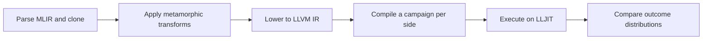

# MLIR-MRacle

A metamorphic testing harness for OpenMP concurrency programs in MLIR.

[](LICENSE)
[]()
[]()

## Overview

MLIR-MRacle is a metamorphic testing tool for OpenMP MLIR programs. It applies
memory model-related metamorphic relations (MRs) to transform a program, runs
both the original and the transformed versions on LLJIT, and compares their
outcome sets. Drastic changes in results across the source and transformed programs point to a bug in OpenMP lowering.

This project investigates a metamorphic-testing approach for concurrency and
memory models, developed during an MLSystems research internship. Conventional
testing assumes single-thread execution and falls short on reproducibility
because of nondeterminism and varying memory models across hardware. Metamorphic relations sidestep these problems, alongside the oracle problem.

MLIR-MRacle is (afaik) the first MLIR fuzzer that can generate valid concurrent
programs with respect to concurrency constructs and the native
memory model, allowing the systematic exploration of a whole class of MLIR programs that was previously out of reach.

## Repository layout

```text
.
├── mlir-mracle/
│   ├── include/mlir-mracle/   # public headers
│   └── src/
│       ├── app/               # mlir_mracle_opt CLI driver
│       └── lib/
│           ├── backend/
│           │   ├── jit/       # JIT-compiles LLVM modules for execution
│           │   └── lowering/  # lowers MLIR to LLVM IR
│           ├── context/       # shared data structures and outcome-set types
│           ├── execution/     # runs compiled binaries and collects observed outcomes
│           ├── io/            # serializes results and dumps IR artifacts
│           ├── legacy/        # legacy thread-group oracle pipeline (--mode=legacy)
│           ├── oracle/        # compares outcome distributions and derives verdicts
│           ├── pipeline/      # pipeline orchestration, emit and execution modes
│           └── passes/        # metamorphic transformation passes
├── fuzzing/
│   ├── fuzz_mracle.py         # primary campaign runner
│   └── corpus/
│       └── seeds/             # litmus-style MLIR seed programs
├── debug-progs/               # small MLIR programs for manual debugging
├── CMakeLists.txt
├── Dockerfile
└── requirements.txt
```

## Architecture



1. Parse the input module and clone it.
2. Apply one or more seeded, semantics-preserving transforms from the
   registry to the clone.
3. Lower both modules to LLVM IR.
4. Collect independent campaigns for both sides on LLJIT.
5. Compare the observed outcome distributions and report a verdict.

## Features

- 20+ seeded metamorphic transformations (see [Transforms](#transforms)).
- A distributional oracle over equality/subset/superset relations (see [Oracle](#oracle)).
- Structured campaign output with per-run JSON reports and artifacts (see [Output layout](#output-layout)).
- Campaign checkpointing and resuming, so an interrupted campaign can be continued via `--campaign-dir`.
- Python runner and over 30+ litmus-style seeds in `./fuzzing/corpus/seeds`.
- Extensible to any memory model; ARMv8 currently supported

## Quick start

### Prerequisites

- Docker, or natively: `uv` (provides Python 3.12, CMake, and Ninja), a C++23
  compiler, and OpenMP (Homebrew `libomp` on Apple Silicon is auto-detected).
- LLVM/MLIR come from the `mlir-wheel` package pinned in `requirements.txt`.

### Native build

```bash
uv python install 3.12
uv venv --python 3.12
uv pip install -r requirements.txt

.venv/bin/cmake -G Ninja -S . -B build -DCMAKE_BUILD_TYPE=Release \
  -DCMAKE_PREFIX_PATH=$(.venv/bin/python -m mlir_wheel --root-dir)

.venv/bin/cmake --build build --target mlir_mracle_opt -j
```

> [!TIP]
> The Python runner builds `mlir_mracle_opt` for you on first use, so the
> native build is optional for normal use.

### Docker

```bash
git clone https://github.com/dakaidan/MLIR-MRacle.git
docker build -t mlir-mracle .
docker run -it --rm mlir-mracle /bin/bash
```

> [!NOTE]
> `mlir_mracle-smoke` is a stable Docker build target that currently just
> echoes configuration success.

## Running MLIR-MRacle

### Python runner (recommended)

```bash
.venv/bin/python fuzzing/fuzz_mracle.py fuzzing/corpus/seeds
```

Examples:

```bash
# single litmus test
.venv/bin/python fuzzing/fuzz_mracle.py fuzzing/corpus/seeds/iriw.mlir

# fixed seed, one random file from the corpus per run
.venv/bin/python fuzzing/fuzz_mracle.py --seed=7 --multi fuzzing/corpus/seeds

# restrict to fence transforms
.venv/bin/python fuzzing/fuzz_mracle.py --transform=insert-fence,remove-fence fuzzing/corpus/seeds/iriw.mlir

# add ARMv8-specific commutations
.venv/bin/python fuzzing/fuzz_mracle.py --model=armv8 fuzzing/corpus/seeds/iriw.mlir

# emit transformed MLIR only
.venv/bin/python fuzzing/fuzz_mracle.py --mode=emit --transform=insert-fence fuzzing/corpus/seeds/iriw.mlir

# resume an interrupted campaign
.venv/bin/python fuzzing/fuzz_mracle.py --campaign-dir=path/to/campaign fuzzing/corpus/seeds
```

### Using the binary directly

```bash
.venv/bin/cmake --build build --target mlir_mracle_opt -j
build/mlir-mracle/src/app/mlir_mracle_opt [options] <path-to-mlir-file>
```

The binary prints the campaign directory on stdout and accepts the same options as the Python driver.

### Options

| Option | Meaning |
| --- | --- |
| `--mode` | pipeline mode(s), comma-separated: `emit`, `execution`, `legacy`, `compare` (default `compare`) |
| `--model` | memory model gate: empty = generic transforms only, `armv8` adds ARMv8-specific ones |
| `--reps` | executions per file in `execution` mode, transform picks in `emit` mode (default 5000) |
| `--iter` | number of pipeline repetitions (default 1) |
| `--transform` | restrict the transform set (repeat or comma-separate) |
| `--apply` | max transform applications per run |
| `--multi` | pick a random `.mlir` file from a folder per run |
| `--seed` | fixed RNG seed |
| `--campaign-dir` | resume/continue a campaign, or the emit-mode output directory |
| `--campaigns` | campaigns collected per variant before the first verdict, and the size of each later batch (default 10) |
| `--max-campaigns` | campaign cap while a verdict stays inconclusive (default 50, a rerun budget of 100,000 executions per variant) |
| `--executions-per-campaign` | executions per campaign (default 2000) |
| `--team-size` | OpenMP team size, identical for both variants (default 4) |
| `--tvd-threshold` | tolerated distributional discrepancy (default 0.05) |
| `--bootstrap` | campaign-level bootstrap replicates (default 2000) |
| `--confidence` | confidence level of the interval (default 0.95) |
| `--threshold` | share of runs a support violation must reach to fail a run, 0–100 (default 5) |
| `--reruns` | legacy replay-round budget (default 5000) |
| `--max-runs` | legacy replay cap for source runs per baseline (default 100000) |
| `--no-cache` | disable the persistent on-disk cache |

See `.venv/bin/python fuzzing/fuzz_mracle.py --help` for the full list.

### Pipeline Modes

| Mode | What it does |
| --- | --- |
| `compare` (default) | compare the source and transformed outcome distributions under the distributional oracle |
| `execution` | execute each file as-is; no oracle comparison, `.ll` artifacts only |
| `emit` | apply transforms and emit the transformed MLIR only; requires `--transform` |
| `legacy` | legacy thread-group oracle pipeline |

### Environment variables

| Variable | Default | Meaning |
| --- | --- | --- |
| `MLIR_MRACLE_BUILD_DIR` | `<repo>/build` | Where the runner locates (and on first use builds) `mlir_mracle_opt`. |
| `MLIR_MRACLE_CACHE_DIR` | `cache/v2` | Root of the artifact cache; an explicitly empty value disables caching. |

## Transforms

Transforms are the seeded, semantics-preserving mutations applied to the cloned program; each one declares the outcome-set relation it preserves and the memory model it targets.

Each transform declares the outcome-set relation it preserves; a run compares
in the direction given by the composition of the transforms actually applied.
Transforms also declare a memory-model target, and the set of applicable
transforms is resolved from the requested model (`--model`): `generic`
transforms are always included, and a non-empty model adds the transforms
targeting that model.

### Generic concurrency transforms

Always available and valid under every memory model.

| Transform | Effect | Relation |
| --- | --- | --- |
| `insert-fence` | insert `omp.flush` inside a thread region | subset |
| `remove-fence` | remove a random `omp.flush` | superset |
| `insert-fence-between-mem-ops` | insert `omp.flush` between atomic memory ops | subset |
| `insert-fence-around-seq-cst` | `omp.flush` around a seq_cst atomic op | equality |
| `insert-atomic-cas` | no-op CAS on a fresh thread-local location | equality |
| `insert-atomic-write` | atomic write of 0 to a thread-local dummy | equality |
| `insert-atomic-read` | atomic read of an in-scope memref | equality |
| `insert-read-arith` | wrap an atomic write expr in `add/sub 0` | equality |
| `insert-random-arith` | fresh memref + arith chain in a thread region | equality |
| `insert-random-memref` | fresh memref load/store chain in a thread region | equality |
| `insert-jitter` | delay chains in gaps around shared-memory ops | equality |
| `insert-comparison` | self-comparisons after a thread value | equality |
| `insert-both-arms-if` | duplicate a chain into both arms of `scf.if` | equality |
| `insert-parallel` | new `omp.parallel` with random sections | equality |
| `insert-critical` | wrap a thread-local chain in `omp.critical` | subset |
| `local-store-duplication` | duplicate a thread-local store | equality |
| `load-reordering` | shuffle eligible loads inside threads | equality |
| `relax-operation` | weaken atomic memory order one stage | superset |
| `restrict-operation` | strengthen atomic memory order one stage | subset |
| `unroll-single-thread` | unroll a single-section `omp.parallel` | equality |

### Memory-model-specific transforms

Transforms for a specific memory model live under
`mlir-mracle/src/lib/passes/transforms/<model>/` e.g. the ARMv8 relaxed
commutations in `transforms/arm/ArmTransforms.cpp`. 

Each declares its target via
`getTarget()` (`MetamorphicTransform.h`), and `getTransforms()` in
`MetamorphicTransform.cpp` adds it to the applicable set only when the
requested `--model` matches.

## Measurement protocol

The `compare` mode measures a distribution, so it never perturbs the program it
is measuring. Every campaign compiles a fresh clone at a fixed CodeGen opt level
and runs it at one team size, so campaign-to-campaign variation comes from
compilation and scheduling rather than from deliberately changed code layout.

- **Campaigns** — `--campaigns` fresh compilations per variant (default 10), each
  running `--executions-per-campaign` executions (default 2000), for 20,000
  executions per variant and 40,000 in total at the default budget.
- **Rerun budget** — an undecided comparison buys another batch of `--campaigns`
  campaigns at a time up to `--max-campaigns` (default 50), so it may spend up to
  100,000 executions per variant before reporting that it cannot decide. Only the
  campaigns actually collected are compiled and executed.
- **Runtime configuration** — one fixed team size for both variants and all
  campaigns (`--team-size`, default 4), not a sweep.
- **Ordering** — the two variants alternate campaign by campaign, so machine load
  and ordering effects are not tied to one side.
- **Determinism probe** — the first campaign also runs 32 single-thread
  executions per side; both sides must agree on exactly one outcome or the run
  fails.
- **Shared state** — the OpenMP runtime settings are process-wide, and each
  campaign creates its own JIT instance. Both are recorded in `run_info.json`
  under `protocol.shared_state`.
## Verdicts

Each run reports `OK`, `WARN` or `FAIL` (written as `BAD` in the `distribution`
block). A run fails when either of two components finds decisive evidence.

### Distributional comparison

The observed outcomes of a campaign are normalized into an empirical
distribution, and the two variants are compared with a relation-masked
discrepancy in `[0, 1]`:

- **equality** — the total variation distance over the union of outcomes.
- **subset** — the probability mass the transformed variant places on outcomes
  the source never produced.
- **superset** — the probability mass the source produced that the transformed
  variant no longer produces.

Campaigns are resampled with replacement (`--bootstrap` replicates, default
2000) to obtain a confidence interval for that discrepancy. The verdict follows
solely from the interval and the tolerance (`--tvd-threshold`, default 0.05):
an interval at or below the tolerance is `OK`, one entirely above it is `FAIL`,
and one straddling it is inconclusive, which buys another batch of campaigns.

Each verdict states its reason in one line, and the verdict itself carries the
severity, so the reason is not prefixed with it: a distributional verdict reports
the difference as a percentage of probability, and a verdict resting on a single
outcome names that outcome and the side that lacks it.

```text
programs differ by 0.40% of probability
new outcome [1, 2] not found in source
```

The confidence interval, tolerance, campaign and execution counts stay in the
`distribution` block of `run_info.json`.

### Support check

An outcome that only one variant produces is a candidate support violation,
judged against a **fluke band** built from the other side's own evidence. Two
questions set it: what can a sample this size hide, and what does that side's
own sample suggest is hiding? For `n` executions and a `p < 1e-6` evidence bar
the sampling bound is ~`13.8/n`; the empirical estimate comes from outcomes seen
exactly once (`N1/N`), averaged over campaigns. The band is the larger of the
two, so it stays a bound rather than a guess. A source full of one-off outcomes
therefore widens its own band, and a source whose outcomes are well covered keeps
the sampling bound.

| Occurrences on the offending side | Outcome |
| --- | --- |
| at or below the band | ignored |
| above it, but not yet established | more campaigns are collected, if they could still establish it |
| established, at or above `--threshold` (5%) | `FAIL` |
| established but below `--threshold`, or never establishable | ignored |

Before buying campaigns the oracle projects the observed rate onto the budget
still reachable and asks whether the occurrence would clear the evidence bar
there. A candidate that could never be established is recorded and left alone
instead of being sampled for, so a comparison that cannot be settled stops
spending rather than running to the cap.

A rare outcome that never gathers enough evidence is dropped rather than warned
about: too rare to confirm is too rare to reason about. It stays recorded in the
run's `support_violations`, so nothing is lost, and it does not stop the rest of
the comparison from being `OK`.

Both directions are checked under equality; subset judges only added outcomes and
superset only dropped ones. A `FAIL` from either component is reported
immediately with the offending outcome, so the artifacts name what changed.

## Output layout

A campaign is written to `<campaign-dir>/<status>/run<N>_seed<S>/`:

- `source.mlir`, `transformed.mlir`, `lowered.mlir`
- `source.ll`, `transformed.ll`
- `run_info.json` — transform applications, verdict, structured `issues` (each
  with `status` FAIL/WARN, `outcome` and `reason`), the per-campaign
  `binary_results` (each with its configuration seed and frequency map), a
  `distribution` block (verdict, discrepancy, interval, campaign and support
  counts), a `protocol` block, and the `support_violations` found.

The `distribution` block carries the evidence behind the verdict - discrepancy,
interval, threshold, campaigns and executions - as diagnostics; the verdict
itself never requires reading them.

`<campaign-dir>/result.json` aggregates the per-run results, and `sanitizer.log`
records any ThreadSanitizer reports, which are reported whatever the verdict and
whatever their frequency. `--mode=execution` writes a bare `source.ll` per run;
`--mode=emit` writes `run<N>_seed<S>.mlir` variants.

## Testing

```bash
.venv/bin/cmake --build build --target mlir_mracle_oracle_test mlir_mracle_legacy_oracle_test -j
ctest --test-dir build --output-on-failure
```

The oracle tests cover the discrepancy arithmetic, the relation masking, the
support-check evidence ladder, the bootstrap, the campaign budget and the
verdict combination. Each run's `run_info.json` carries the discrepancy,
interval, campaign counts and support sizes behind its verdict, so the same
figures can be read straight from any campaign.

## Troubleshooting

- **Apple Silicon OpenMP**: Homebrew `libomp` is auto-detected; ensure it is
  installed before configuring.
- **Repeated re-lowering**: delete the cache dir (`cache/v2`) to force fresh
  lowering of all modules.
- **ThreadSanitizer**: the tool is built with TSan (`-fsanitize=thread`), so
  TSan reports surface in `sanitizer.log`; the runner classifies such a campaign
  as an error regardless of the verdict.
- **Everything is `WARN`**: a `WARN` means the comparison could not be decided
  within the campaign budget. Raise `--max-campaigns`, or lower
  `--executions-per-campaign` if the programs are slow.

## Pull requests

This is an emerging codebase, so PRs do not need to be polished. Metamorphic transformations for
other hardware targets or memory models are especially appreciated.

Contact me at **aarongaba05@gmail.com** if you have any questions.
