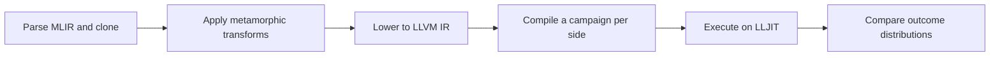

# MLIR-MRacle

A metamorphic testing harness for OpenMP concurrency programs in MLIR.

[](LICENSE)
[]()
[]()

## Overview

MLIR-MRacle is a metamorphic testing tool for OpenMP MLIR programs. It applies
memory model-related metamorphic relations (MRs) to transform a program, runs
both the original and the transformed versions on LLJIT, and compares their
outcome sets. Drastic changes in results across the source and transformed programs point to a bug in OpenMP lowering.

This project investigates a metamorphic-testing approach for concurrency and
memory models, developed during an MLSystems research internship. Conventional
testing assumes single-thread execution and falls short on reproducibility
because of nondeterminism and varying memory models across hardware. Metamorphic relations sidestep these problems, alongside the oracle problem.

MLIR-MRacle is (afaik) the first MLIR fuzzer that can generate valid concurrent
programs with respect to concurrency constructs and the native
memory model, allowing the systematic exploration of a whole class of MLIR programs that was previously out of reach.

## Repository layout

```text
.
├── mlir-mracle/
│   ├── include/mlir-mracle/   # public headers
│   └── src/
│       ├── app/               # mlir_mracle_opt CLI driver
│       └── lib/
│           ├── backend/
│           │   ├── jit/       # JIT-compiles LLVM modules for execution
│           │   └── lowering/  # lowers MLIR to LLVM IR
│           ├── context/       # shared data structures and outcome-set types
│           ├── execution/     # runs compiled binaries and collects observed outcomes
│           ├── io/            # serializes results and dumps IR artifacts
│           ├── legacy/        # legacy thread-group oracle pipeline (--mode=legacy)
│           ├── oracle/        # compares outcome distributions and derives verdicts
│           ├── pipeline/      # pipeline orchestration, emit and execution modes
│           └── passes/        # metamorphic transformation passes
├── fuzzing/
│   ├── fuzz_mracle.py         # primary campaign runner
│   └── corpus/
│       └── seeds/             # litmus-style MLIR seed programs
├── debug-progs/               # small MLIR programs for manual debugging
├── CMakeLists.txt
├── Dockerfile
└── requirements.txt
```

## Architecture



1. Parse the input module and clone it.
2. Apply one or more seeded, semantics-preserving transforms from the
   registry to the clone.
3. Lower both modules to LLVM IR.
4. Collect independent campaigns for both sides on LLJIT.
5. Compare the observed outcome distributions and report a verdict.

## Features

- 20+ seeded metamorphic transformations (see [Transforms](#transforms)).
- Three comparison oracles over the same campaign protocol — agitation,
  distributional and noise-calibrated (see [Modes](#modes)).
- Structured campaign output with per-run JSON reports and artifacts (see [Output layout](#output-layout)).
- Campaign checkpointing and resuming, so an interrupted campaign can be continued via `--campaign-dir`.
- Python runner and over 30+ litmus-style seeds in `./fuzzing/corpus/seeds`.
- Extensible to any memory model; ARMv8 currently supported

## Quick start

### Prerequisites

- Docker, or natively: `uv` (provides Python 3.12, CMake, and Ninja), a C++23
  compiler, and OpenMP (Homebrew `libomp` on Apple Silicon is auto-detected).
- LLVM/MLIR come from the `mlir-wheel` package pinned in `requirements.txt`.

### Native build

```bash
uv python install 3.12
uv venv --python 3.12
uv pip install -r requirements.txt

.venv/bin/cmake -G Ninja -S . -B build -DCMAKE_BUILD_TYPE=Release \
  -DCMAKE_PREFIX_PATH=$(.venv/bin/python -m mlir_wheel --root-dir)

.venv/bin/cmake --build build --target mlir_mracle_opt -j
```

> [!TIP]
> The Python runner builds `mlir_mracle_opt` for you on first use, so the
> native build is optional for normal use.

### Docker

```bash
git clone https://github.com/dakaidan/MLIR-MRacle.git
docker build -t mlir-mracle .
docker run -it --rm mlir-mracle /bin/bash
```

> [!NOTE]
> `mlir_mracle-smoke` is a stable Docker build target that currently just
> echoes configuration success.

## Running MLIR-MRacle

### Python runner (recommended)

```bash
.venv/bin/python fuzzing/fuzz_mracle.py fuzzing/corpus/seeds
```

Examples:

```bash
# single litmus test
.venv/bin/python fuzzing/fuzz_mracle.py fuzzing/corpus/seeds/iriw.mlir

# fixed seed, one random file from the corpus per run
.venv/bin/python fuzzing/fuzz_mracle.py --seed=7 --multi fuzzing/corpus/seeds

# restrict to fence transforms
.venv/bin/python fuzzing/fuzz_mracle.py --transform=insert-fence,remove-fence fuzzing/corpus/seeds/iriw.mlir

# add ARMv8-specific commutations
.venv/bin/python fuzzing/fuzz_mracle.py --model=armv8 fuzzing/corpus/seeds/iriw.mlir

# emit transformed MLIR only
.venv/bin/python fuzzing/fuzz_mracle.py --mode=emit --transform=insert-fence fuzzing/corpus/seeds/iriw.mlir

# resume an interrupted campaign
.venv/bin/python fuzzing/fuzz_mracle.py --campaign-dir=path/to/campaign fuzzing/corpus/seeds

# the distributional comparison, then the calibrated one
.venv/bin/python fuzzing/fuzz_mracle.py --mode=tvd fuzzing/corpus/seeds/iriw.mlir
.venv/bin/python fuzzing/fuzz_mracle.py --mode=calibrated fuzzing/corpus/seeds/iriw.mlir
```

### Using the binary directly

```bash
.venv/bin/cmake --build build --target mlir_mracle_opt -j
build/mlir-mracle/src/app/mlir_mracle_opt [options] <path-to-mlir-file>
```

The binary prints the campaign directory on stdout and accepts the same options as the Python driver.

### Global options

These apply whatever the mode is; each mode's own options are listed in its
section below.

| Option | Meaning |
| --- | --- |
| `--mode` | pipeline mode(s), comma-separated: `emit`, `execution`, `legacy`, `compare` (default), `tvd`, `calibrated` |
| `--model` | memory model gate: empty = generic transforms only, `armv8` adds ARMv8-specific ones |
| `--iter` | number of pipeline repetitions (default 1) |
| `--transform` | restrict the transform set (repeat or comma-separate) |
| `--apply` | max transform applications per run |
| `--multi` | pick a random `.mlir` file from a folder per run |
| `--seed` | fixed RNG seed |
| `--campaign-dir` | resume/continue a campaign, or the emit-mode output directory |
| `--no-cache` | disable the persistent on-disk cache |

See `.venv/bin/python fuzzing/fuzz_mracle.py --help` for the full list.

### Environment variables

| Variable | Default | Meaning |
| --- | --- | --- |
| `MLIR_MRACLE_BUILD_DIR` | `<repo>/build` | Where the runner locates (and on first use builds) `mlir_mracle_opt`. |
| `MLIR_MRACLE_CACHE_DIR` | `cache/v2` | Root of the artifact cache; an explicitly empty value disables caching. |

## Transforms

Transforms are the seeded, semantics-preserving mutations applied to the cloned program; each one declares the outcome-set relation it preserves and the memory model it targets.

Each transform declares the outcome-set relation it preserves; a run compares
in the direction given by the composition of the transforms actually applied.
Transforms also declare a memory-model target, and the set of applicable
transforms is resolved from the requested model (`--model`): `generic`
transforms are always included, and a non-empty model adds the transforms
targeting that model.

### Generic concurrency transforms

Always available and valid under every memory model.

| Transform | Effect | Relation |
| --- | --- | --- |
| `insert-fence` | insert `omp.flush` inside a thread region | subset |
| `remove-fence` | remove a random `omp.flush` | superset |
| `insert-fence-between-mem-ops` | insert `omp.flush` between atomic memory ops | subset |
| `insert-fence-around-seq-cst` | `omp.flush` around a seq_cst atomic op | equality |
| `insert-atomic-cas` | no-op CAS on a fresh thread-local location | equality |
| `insert-atomic-write` | atomic write of 0 to a thread-local dummy | equality |
| `insert-atomic-read` | atomic read of an in-scope memref | equality |
| `insert-read-arith` | wrap an atomic write expr in `add/sub 0` | equality |
| `insert-random-arith` | fresh memref + arith chain in a thread region | equality |
| `insert-random-memref` | fresh memref load/store chain in a thread region | equality |
| `insert-jitter` | delay chains in gaps around shared-memory ops | equality |
| `insert-comparison` | self-comparisons after a thread value | equality |
| `insert-both-arms-if` | duplicate a chain into both arms of `scf.if` | equality |
| `insert-parallel` | new `omp.parallel` with random sections | equality |
| `insert-critical` | wrap a thread-local chain in `omp.critical` | subset |
| `local-store-duplication` | duplicate a thread-local store | equality |
| `load-reordering` | shuffle eligible loads inside threads | equality |
| `relax-operation` | weaken atomic memory order one stage | superset |
| `restrict-operation` | strengthen atomic memory order one stage | subset |
| `unroll-single-thread` | unroll a single-section `omp.parallel` | equality |

### Memory-model-specific transforms

Transforms for a specific memory model live under
`mlir-mracle/src/lib/passes/transforms/<model>/` e.g. the ARMv8 relaxed
commutations in `transforms/arm/ArmTransforms.cpp`. 

Each declares its target via
`getTarget()` (`MetamorphicTransform.h`), and `getTransforms()` in
`MetamorphicTransform.cpp` adds it to the applicable set only when the
requested `--model` matches.

## Modes

Every mode shares the same front half — parse the input, clone it, apply the
metamorphic transforms, lower to LLVM IR and compile the variants — and differs
in what it does with the result. `compare`, `tvd` and `calibrated` compare the
two variants with a different oracle; `legacy` is the older thread-group
pipeline with its own cache and oracle; `execution` and `emit` do not compare at
all. Select with `--mode`, and repeat or comma-separate the flag to run several
modes in one campaign.

| Mode | Oracle it reports | Section |
| --- | --- | --- |
| `compare` (default) | per-outcome oracle over the agitation sweep | [`compare`](#compare--the-agitation-oracle) |
| `tvd` | distributional oracle | [`tvd`](#tvd--the-distributional-oracle) |
| `calibrated` | noise-calibrated distributional oracle | [`calibrated`](#calibrated--the-noise-calibrated-oracle) |
| `legacy` | thread-group oracle over cached baselines | [`legacy`](#legacy--the-thread-group-pipeline) |
| `execution` | none: executes each file as-is | [without an oracle](#execution-and-emit--without-an-oracle) |
| `emit` | none: emits the transformed MLIR | [without an oracle](#execution-and-emit--without-an-oracle) |

### `compare` — the agitation oracle

The default method compares the two variants as they behave under deliberate
perturbation: each side is compiled into five in-memory JIT variants whose
non-entry basic blocks are shuffled and whose CodeGen optimisation levels are a
permutation of `{0,1,2,3}`, both sides are jittered, and the variants run across
OpenMP team sizes drawn from `{2,3,4,6,8}`. A rare state sends the oracle back
for replays with fresh team-size mixes, and when the replay cap is reached with
a state still unresolved one ThreadSanitizer build per side runs a final round
whose outcomes join the aggregate before the verdict.

| Option | Meaning |
| --- | --- |
| `--reps` | executions per variant configuration (default 5000, i.e. 25,000 per side over the five configurations) |
| `--reruns` | replay-round budget, and the size of the final TSan round (default 5000) |
| `--max-runs` | cap on the executions spent on one baseline while a rare state is unresolved (default 100000) |
| `--threshold` | share of runs, in percent, at which a one-sided outcome stops being rare (default 5) |

The verdicts are the oracle's, `OK`, `WARN` or `FAIL`. A run fails outright on
an arity mismatch or when the two variants disagree at one thread. An outcome
only one variant produces fails at or above `--threshold` of runs when the
Poisson test on the quiet side's predicted count agrees, and warns below it; the
same holds for a value that has never appeared at that position on the other
side. A rate shift between two outcomes both sides produce is judged on the
Poisson test alone and warns, escalating to a failure only when the source rate
sits below `--threshold` and the transformed rate reaches it. ThreadSanitizer
reports are saved to `sanitizer.log` whatever the verdict.

### `tvd` — the distributional oracle

`--mode=tvd` compares distributions instead of perturbing them: the program it
measures is never modified, and there is no triage. Campaigns are collected as
described under [the campaign protocol](#the-campaign-protocol), and each
campaign compiles a fresh clone at a fixed CodeGen optimisation level and runs
it at one team size, so campaign-to-campaign variation comes from compilation
and scheduling rather than from deliberately changed code layout.

| Option | Default | Meaning |
| --- | --- | --- |
| `--campaigns` | 10 | campaigns per variant before the first verdict, and the size of each later batch |
| `--max-campaigns` | 50 | campaign cap while the comparison stays undecided (100,000 executions per variant) |
| `--executions-per-campaign` | 2000 | executions per campaign |
| `--team-size` | 4 | OpenMP team size, identical for both variants |
| `--tvd-threshold` | 0.05 | tolerated distributional discrepancy |
| `--bootstrap` | 2000 | campaign-level bootstrap replicates |
| `--confidence` | 0.95 | confidence level of the interval |

The agitation options (`--reps`, `--reruns`, `--max-runs`, `--threshold`) are
rejected here, because this method measures campaigns rather than executions.

Each run reports `OK`, `WARN` or `FAIL`, and fails when either of its two
components finds decisive evidence.

**Distributional comparison.** The observed outcomes of a campaign are
normalized into an empirical distribution, and the two variants are compared
with a relation-masked discrepancy in `[0, 1]`:

- **equality** — the total variation distance over the union of outcomes.
- **subset** — the probability mass the transformed variant places on outcomes
  the source never produced.
- **superset** — the probability mass the source produced that the transformed
  variant no longer produces.

Campaigns are resampled with replacement (`--bootstrap` replicates) to obtain a
confidence interval for that discrepancy, and the verdict follows solely from
the interval and the tolerance: an interval at or below the tolerance is `OK`,
one entirely above it is `FAIL`, and one straddling it is undecided, which buys
another batch of campaigns and becomes a `WARN` if the cap is reached.

**Support check.** An outcome that one variant produces and the other does not
*meaningfully* produce is a categorical violation: the other side's count must
exceed its own fluke band before the outcome counts as present there. That covers
0 → 300 and 1 → 300 alike, since a single occurrence is not evidence of
meaningful production. The band is built from the quiet side's own evidence and
two questions set it: what can a sample this size hide, and what does that side's
own sample suggest is hiding? For `n` executions and a `p < 1e-6` evidence bar
the sampling bound is ~`13.8/n`; the empirical estimate comes from outcomes seen
exactly once (`N1/N`), averaged over campaigns. The band is the larger of the
two, so it stays a bound rather than a guess.

| Occurrences on the offending side | Outcome |
| --- | --- |
| at or below the band | ignored |
| unlikely under the other variant's sampling (`p < 0.05`) | `WARN`, however rare |
| established (`p < 1e-6`) | `FAIL` |
| above the band but pointing nowhere yet | more campaigns are collected, if they could still establish it |
| never establishable | recorded, does not keep the run open |

The counts are budget-independent because the band tightens with the sample: 21
occurrences start warning and 36 establish a failure at any budget, which is
0.105%/0.18% of runs at 20,000 per side and 0.021%/0.036% at 100,000. Before
buying campaigns the oracle projects the observed rate onto the budget still
reachable and asks whether the occurrence would clear the evidence bar there. A
rare outcome that never gathers enough evidence is recorded in
`support_violations` rather than warned about, so it does not stop the rest of
the comparison from being `OK`.

Both components are masked by the relation: equality judges both directions,
subset only added outcomes and superset only dropped ones. A `FAIL` is reported
immediately with the offending outcome, so the artifacts name what changed, and
each verdict states its reason in one line with the severity carried separately.

### `calibrated` — the noise-calibrated oracle

`--mode=calibrated` judges the same campaign protocol as `tvd` with a single
distributional score and a bar it measures from the campaigns themselves. It has
no per-outcome guards, no support check and no fixed percentage cutoff: a change
is reported when it exceeds both the variability this comparison actually showed
and a minimum practical change.

| Option | Default | Meaning |
| --- | --- | --- |
| `--campaigns` | 10 | campaigns per variant before the first verdict, and the size of each later batch |
| `--max-campaigns` | 30 | campaign cap while the comparison stays undecided (30,000 executions per variant) |
| `--executions-per-campaign` | 1000 | executions per campaign |
| `--team-size` | 4 | OpenMP team size, identical for both variants |
| `--min-change` | 0.005 | smallest change worth reporting, in squared Hellinger distance |
| `--bootstrap` | 2000 | resamples that build the noise envelope |
| `--confidence` | 0.95 | confidence of the calibrated bar |

**The score.** Both variants are pooled into normalized distributions over the
complete joint outcomes, and the distance between them is the squared Hellinger
distance `1 - Σ √(p·q)` over the union of outcomes they produced. Zero counts
need no pseudocount, and the score is proportional: an outcome's own probability
decides how much its movement weighs, so rare-outcome changes dominate common
ones at the same budget.

| Change | Score |
| --- | --- |
| identical pooled distributions | 0.0000 |
| 70% / 30% → 67.5% / 32.5% | 0.0004 |
| 70% / 30% → 65% / 35% | 0.0014 |
| a new outcome at 0.5% of runs | 0.0027 |
| 0.75% → 3% on a rare outcome | 0.0038 |
| 70% / 30% → 60% / 40% | 0.0055 |
| 0.75% → 5% on a rare outcome | 0.0096 |
| 70% / 30% → 50% / 50% | 0.0211 |
| a new outcome at 10% of runs | 0.0513 |
| two variants that share no outcome at all | 1.0000 |

The floor of 0.005 therefore sits between a rare outcome growing to 3% of runs
and one growing to 5%, and between a common outcome moving 7 and 10 points. It
is the single sensitivity knob: raise it to stop chasing small differences, lower
it to report them, and read the `calibration` block to see whether the bar came
from the floor or from the noise envelope.

**The noise envelope.** The bar is calibrated from the data rather than assumed:
the campaigns of both sides are reshuffled into two groups of the sizes actually
collected (`--bootstrap` resamples), each reshuffle is scored the same way, and
the bar is the high quantile of those scores at this budget. Compilation and
scheduling variability are therefore inside the bar, because each campaign is
its own build. The comparison refuses to decide below `--min-change` whatever
the envelope says.

Calibration costs time in the oracle and no executions at all, and it is what
makes a single cutoff unnecessary: the size a score reaches by chance depends on
how many executions were spent, how many outcomes exist and how much a program's
own distribution moves between builds, so the same change is a large score on a
quiet program and a small one on a noisy program. Measured on the seeds in this
repository at 10 campaigns per side, the envelope is 0.0000 for a deterministic
program and 0.0035-0.0090 for the racy ones - above the floor, so there the
calibrated bar is what decides. The envelope shrinks as campaigns accumulate
(0.00031, 0.00017, 0.00010 at 10, 20 and 30 campaigns), so an undecided
comparison becomes decidable by collecting more evidence rather than by moving a
constant.

**The decision.** A score above the bar fails; a score below the practical floor
passes; a score between the two is undecided, and the comparison buys more
campaigns while the budget allows. The false-alarm budget is shared across the
judgements the budget permits, so repeated looks do not turn noise into
findings, and a comparison that reaches the cap still undecided is reported as
`INCONCLUSIVE` (a `WARN` on the run) rather than as equivalence.

The comparison is symmetric: it measures how far apart the two pooled
distributions are, and does not use the transform relation to excuse a
difference in either direction.

The evidence behind a verdict — score, envelope, floor, the resulting bar,
campaign and outcome counts — is written to the `calibration` block of
`run_info.json` for debugging; the verdict itself needs none of it.

### `legacy` — the thread-group pipeline

`--mode=legacy` is the older pipeline, kept for comparison. It compares each
thread count separately, over a fixed set of levels: 1, 2, 4 and 8 threads. The
one-thread level is a determinism probe of 32 executions per side, and every
multi-threaded comparison runs ThreadSanitizer-instrumented builds. The source
side is served from an in-memory per-file memo and a persistent baseline cache
keyed by thread count, so repeated campaigns of the same source reuse the
baseline; whichever side is short of outcomes is retested in `--reruns` steps up
to `--max-runs` until it is saturated. Transforms come from the ARMv8 set, and
the options are the agitation ones: `--reps`, `--reruns`, `--max-runs` and
`--threshold`, with the same defaults.

Its oracle judges one direction at a time against the source baseline. A novel
outcome in the equality and subset directions, or a missing one in the superset
direction, fails at or above `--threshold` of runs, as does a shared outcome
whose source rate sits below `--threshold` and whose transformed rate reaches
it. A count outside the two-sided Poisson range of the source-predicted count
warns, and an arity mismatch or a one-thread disagreement fails.

### `execution` and `emit` — without an oracle

`--mode=execution` runs each input file as it is, `--reps` executions per file,
and writes the lowered `source.ll` with the observed outcomes but no comparison.
`--mode=emit` applies the requested transforms (`--transform` is required) and
writes one transformed `.mlir` per run into `--campaign-dir`.

## The campaign protocol

`tvd` and `calibrated` are the same measurement with two different judges, so the
protocol they share is described once here.

- **Campaigns** — `--campaigns` fresh compilations per variant (default 10),
  each running `--executions-per-campaign` executions, for 20,000 executions per
  variant and 40,000 in total under the `tvd` defaults.
- **Rerun budget** — an undecided comparison buys another batch of `--campaigns`
  campaigns at a time up to `--max-campaigns`, so it may spend up to the cap
  before reporting that it cannot decide. Only the campaigns actually collected
  are compiled and executed.
- **Runtime configuration** — one fixed team size for both variants and all
  campaigns (`--team-size`, default 4), not a sweep.
- **Ordering** — the two variants alternate campaign by campaign, so machine load
  and ordering effects are not tied to one side.
- **Determinism probe** — the first campaign also runs 32 single-thread
  executions per side; both sides must agree on exactly one outcome or the run
  fails.
- **Shared state** — the OpenMP runtime settings are process-wide, and each
  campaign creates its own JIT instance. Both are recorded in `run_info.json`
  under `protocol.shared_state`.

Campaigns are the unit of sampling and of uncertainty for both judges: the
comparison is never narrower than the campaign-to-campaign variation it actually
saw, whether that variability enters through a bootstrap (`tvd`) or through the
reshuffling that builds the calibrated bar.

## Output layout

A campaign is written to `<campaign-dir>/<status>/run<N>_seed<S>/`:

- `source.mlir`, `transformed.mlir`, `lowered.mlir`
- `source.ll`, `transformed.ll`
- `run_info.json` — transform applications, verdict, structured `issues` (each
  with `status` FAIL/WARN, `outcome` and `reason`), the per-campaign
  `binary_results` (each with its configuration seed and frequency map), and the
  evidence block of the method that ran: under `tvd`, a `distribution` block
  (verdict, discrepancy, interval, campaign and support counts) with the
  `support_violations` found; under `calibrated`, a `calibration` block (score,
  noise envelope, floor, resulting bar, campaign, run and support counts). Both
  carry a `protocol` block describing how the campaigns were collected.

The `distribution` block carries the evidence behind the verdict - discrepancy,
interval, threshold, campaigns and executions - as diagnostics; the verdict
itself never requires reading them.

`<campaign-dir>/result.json` aggregates the per-run results, and `sanitizer.log`
records any ThreadSanitizer reports, which are reported whatever the verdict and
whatever their frequency; the `legacy` pipeline additionally persists source
baselines in the cache so later campaigns reuse them. `--mode=execution` writes a
bare `source.ll` per run; `--mode=emit` writes `run<N>_seed<S>.mlir` variants.

## Testing

```bash
.venv/bin/cmake --build build --target mlir_mracle_oracle_test mlir_mracle_calibrated_test mlir_mracle_poisson_oracle_test mlir_mracle_legacy_oracle_test -j
ctest --test-dir build --output-on-failure
```

One suite per oracle: `poisson_oracle_test` covers the per-outcome oracle of
`compare`, `oracle_test` covers the distributional oracle of `tvd`,
`calibrated_test` covers the calibrated oracle, and `legacy_oracle_test` covers
the legacy pipeline. The `tvd` suite covers the discrepancy arithmetic, the
support-check evidence ladder, the bootstrap, the campaign budget and the verdict
combination. The `calibrated` suite is the validation battery for its score and
its bar: the distance arithmetic, rare emergences, unseen outcomes and singleton
collections, common-outcome changes, unequal budgets, campaign-to-campaign
variability, the undecided rule, and two batches that measure the false-alarm
rate on known-equivalent comparisons and the detection rate on a rare emergence.
Each run's `run_info.json` carries the numbers behind its verdict, so the same
figures can be read straight from any campaign.

## Troubleshooting

- **Apple Silicon OpenMP**: Homebrew `libomp` is auto-detected; ensure it is
  installed before configuring.
- **Repeated re-lowering**: delete the cache dir (`cache/v2`) to force fresh
  lowering of all modules.
- **ThreadSanitizer**: the tool is built with TSan (`-fsanitize=thread`), so
  TSan reports surface in `sanitizer.log`; the runner classifies such a campaign
  as an error regardless of the verdict.
- **Everything is `WARN`**: under `tvd` and `calibrated` a `WARN` means the
  comparison could not be decided within the campaign budget, which for
  `calibrated` means the change sits between the practical floor and the noise
  envelope. Raise `--max-campaigns`, lower `--executions-per-campaign` if the
  programs are slow, or raise `--min-change` if the differences being reported
  are not worth chasing. Under `compare` and `legacy` a `WARN` is a deviation
  the oracle saw but would not call a failure on its own, such as a rare outcome
  or a rate shift between outcomes both sides produce.

## Pull requests

This is an emerging codebase, so PRs do not need to be polished. Metamorphic transformations for
other hardware targets or memory models are especially appreciated.

Contact me at **aarongaba05@gmail.com** if you have any questions.
